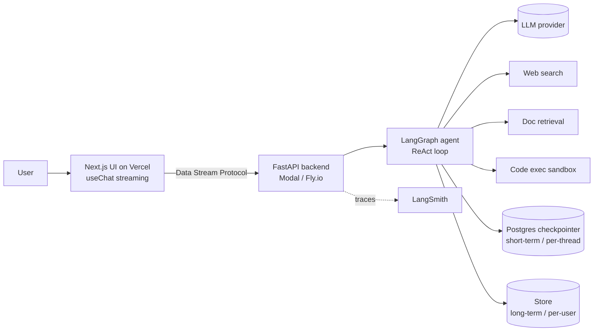

# Shipping an Agent

This tutorial assumes you already have a basic working agent (an LLM in a loop that can call tools) and focuses on everything *around* it that makes it production-worthy.

The six parts: **memory**, **edge cases**, **streaming UI**, **deploy**, **demo video**, and **write-up**.

> **Note on version names.** Model and package names (`claude-sonnet-4-6`, Postgres, Modal, Fly.io, Vercel) are current examples; check each platform's docs for exact commands. The patterns are the stable part.

---

## Part 1 — Add memory: persist the conversation and a long-term store

### Why this exists (the problem)

An agent with no memory is amnesiac: it forgets your last message the moment a call ends, and forgets *you* entirely between sessions. Production assistants need **two** kinds of memory:

- **Short-term (thread-scoped)** — remembering *within one conversation*: what was said a few turns ago. Implemented by persisting the agent's state per conversation.
- **Long-term (cross-thread)** — remembering *across conversations*: a user's name, preferences, past decisions. Implemented with a separate store keyed by user, not by conversation.

### Short-term memory: persist the conversation

Attach a **checkpointer** at compile time and pass a **`thread_id`** on each call. Every invocation with the same `thread_id` reloads the prior state, so the agent has context. The critical production choice is *which* checkpointer:

```python
from langgraph.prebuilt import create_react_agent
from langgraph.checkpoint.postgres import PostgresSaver     # DURABLE — survives restarts
# from langgraph.checkpoint.sqlite import SqliteSaver       # single-machine file alternative
# from langgraph.checkpoint.memory import InMemorySaver     # DEV ONLY — lost on restart

checkpointer = PostgresSaver.from_conn_string(DB_URI)       # call .setup() once to create tables
agent = create_react_agent(model, tools=tools, checkpointer=checkpointer)

config = {"configurable": {"thread_id": "user-1:session-3"}}
agent.invoke({"messages": [{"role": "user", "content": "My name is Bob."}]}, config)
agent.invoke({"messages": [{"role": "user", "content": "What's my name?"}]}, config)  # -> "Bob"
```

> **Gotcha — in-memory checkpointers vanish in production.** `InMemorySaver` keeps state in RAM, so it's wiped on every restart *and* between serverless invocations (where each request may hit a fresh process). It's fine for local development, but for anything deployed use a durable checkpointer — `SqliteSaver` (single machine) or `PostgresSaver` (production, with a managed database like Neon/Supabase/RDS). This is one of the most common "works locally, breaks in prod" bugs.

### Long-term memory: a cross-thread store

For memory that outlives a single conversation, LangGraph provides a **Store** — a key-value memory organized into **namespaces** (arbitrary scopes, e.g. one per user) that any thread can read or write. You attach it at compile time and use `put`/`get`/`search`:

```python
from langgraph.store.memory import InMemoryStore    # dev; use a persistent store in production
store = InMemoryStore()

ns = ("user-1", "memories")                          # namespace: scope memories to this user
store.put(ns, "diet", {"fact": "vegetarian"})        # write a long-term fact
item = store.get(ns, "diet")                         # read it back later, from ANY thread
hits = store.search(ns, query="food preferences")    # search (semantic, if the store has embeddings configured)

store.get(("user-2", "memories"), "diet")            # a DIFFERENT user's namespace -> None
```

You attach it to the agent (`create_react_agent(..., store=store)`), and nodes/tools can read and write it — for example, a step that saves a fact the user mentioned, so a future conversation can recall it.

> **Gotcha — cross-user memory pollution.** If your namespace (or key) scheme isn't isolated per user, one user's facts can surface in another user's session — a privacy and correctness failure. Namespace by a stable user identifier, enforce that scoping at the storage layer, and write a test that stores a fact as user A and confirms user B can't retrieve it.

> **Gotcha — memory grows without bound.** Checkpoints accumulate per thread and store entries pile up over time, raising storage and latency. Prune old threads/entries or set a retention policy. And don't put large blobs (files, big documents) into state or a checkpoint — they get copied on every step; store a reference instead.

### Hands-on exercise (Part 1)

1. Swap your agent's checkpointer to `SqliteSaver` (or Postgres). Have a two-turn conversation on one `thread_id`, then **restart your script** and confirm the conversation is still remembered (proof the durable checkpointer works).
2. Start a fresh `thread_id` and confirm it's a clean conversation (isolation).
3. Add a Store, `put` a fact under `("<user>", "memories")`, and `get` it back in a *different* thread — long-term recall across conversations.
4. **Stretch:** `get` the same fact under a *different* user's namespace and confirm it returns nothing — you've verified the anti-pollution boundary.

### Interview questions (Part 1)

1. **Conceptual — "What's the difference between short-term and long-term memory for an agent?"**
   Short-term (thread-scoped) memory remembers within a single conversation and is implemented by persisting the agent's state per `thread_id` via a checkpointer. Long-term (cross-thread) memory remembers across conversations — a user's facts and preferences — and is implemented with a separate store keyed by user (a namespace), readable from any thread.

2. **Gotcha — "Your deployed chatbot forgets everything on redeploy. What's wrong?"**
   You're using an in-memory checkpointer (`InMemorySaver`), which holds state in RAM and loses it on restart and between serverless invocations. Switch to a durable checkpointer — `SqliteSaver` for a single machine or `PostgresSaver` for production.

3. **Practical — "How do you give an agent memory of a specific user across sessions?"**
   Use a Store with a namespace scoped to that user (e.g. `(user_id, "memories")`); write facts with `put` and retrieve them with `get`/`search` from any conversation. Attach the store at compile time so nodes/tools can read and write it.

4. **Gotcha — "What's the most dangerous bug in a multi-user long-term memory system?"**
   Cross-user memory pollution — one user's facts leaking into another's due to weak scoping. Prevent it by namespacing per stable user ID, enforcing scoping at the storage layer, and testing that a fact stored for one user isn't retrievable by another.

5. **Practical — "Why not just keep the entire conversation in memory forever?"**
   Because state and checkpoints grow without bound (storage and latency costs), long histories can exceed the model's context window, and in-memory state isn't durable. You persist to a durable store, prune over time, and keep large data out of state (store a reference).

---

## Part 2 — Edge cases: tool failures, infinite loops, bad outputs

### Why this exists (the problem)

Your agent works on the inputs you tried; production sends it everything else. Robustness is mostly about handling three failure classes gracefully: **tool failures** (the world is flaky), **infinite loops** (the agent gets stuck), and **bad outputs** (the model produces something wrong or unsafe). A demo ignores these; a shipped product survives them.

### Tool failures

Tools call the messy real world — networks time out, APIs return errors, inputs are malformed. Handle failure at two points:

- **Validate inputs** before executing, since the arguments come from an LLM and may be malformed. Reject bad input and return a clear message instead of crashing.
- **Return the error to the model** rather than raising, so the agent can adapt (retry differently, try another tool, or tell the user). LangGraph's `ToolNode` does this for you: with error handling enabled, a tool exception becomes an error result the model sees, instead of crashing the run.

```python
from langgraph.prebuilt import ToolNode
tool_node = ToolNode(tools, handle_tool_errors=True)   # tool exceptions -> error results the model can react to

# inside a tool:
from pydantic import BaseModel, ValidationError
def safe_lookup(raw_args: dict):
    try:
        args = LookupArgs(**raw_args)          # validate first
    except ValidationError as e:
        return f"Invalid input: {e}"           # a message the model can recover from
    try:
        return do_lookup(args)
    except TransientError:
        ...                                    # retry transient failures with backoff
    except Exception as e:
        return f"Lookup failed: {e}"           # don't crash; report so the model doesn't hallucinate
```

> **Gotcha — silent failure causes hallucination.** If a tool fails and you return nothing (or a misleadingly-successful result), the model will often invent a plausible answer to fill the gap. Fail *loudly* — return an explicit error — so the model knows it lacks real data.

> **Gotcha — only retry the right failures, and never blindly retry side effects.** Retry *transient* failures (network blips, rate limits) with exponential backoff; don't retry *permanent* ones (bad request, not found). And never blindly retry a non-idempotent action (charge a card, send an email) — if the first attempt actually succeeded but the response was lost, a retry double-executes it. Use idempotency keys or check state first.

### Infinite loops

A tool-using agent can loop forever — call a tool, get a confusing result, call it again, endlessly. LangGraph caps this with a **recursion limit** (a maximum number of steps per run, default 25) that raises an error when exceeded. Catch it and degrade gracefully, and fix the root cause (usually a vague prompt or ambiguous routing):

```python
from langgraph.errors import GraphRecursionError
try:
    result = agent.invoke(user_input, {"configurable": {"thread_id": t}, "recursion_limit": 25})
except GraphRecursionError:
    result = "I couldn't finish that within my step budget — could you narrow the request?"
```

> **Gotcha — raising the recursion limit is not the fix.** Hitting the limit almost always means a loop that isn't terminating (the model keeps calling a tool without progressing). Bumping the number just delays the failure and burns more tokens. Fix the prompt (clear stop rule) and tool descriptions; treat the limit as a safety net, not a knob to turn up.

### Bad outputs

Even when tools work and the loop terminates, the model can produce output that's malformed, off-format, or unsafe. Guardrail the output before it reaches the user:

- **Schema validation** — if you need structured output, validate it against a schema (e.g. with Pydantic or the model's structured-output mode) and reject or repair anything that doesn't fit.
- **Content/safety checks** — filter unsafe content and detect sensitive data (PII — personally identifiable information) so it isn't leaked. Modern agent frameworks offer guardrail "middleware" or before/after hooks for exactly this.

```python
from pydantic import BaseModel
class Answer(BaseModel):
    text: str
    sources: list[str]
# Validate the final answer against Answer before returning it; if it fails, repair or ask the model to retry.
```

> **Gotcha — don't leak internal errors to users.** When something fails, return a clear, friendly message — never a raw stack trace or internal detail. Stack traces confuse users, look unprofessional, and can leak sensitive implementation details. Log the full error internally; show the user a graceful message.

> **Gotcha — a flaky tool shouldn't stall the whole run.** Without timeouts, one hung tool call can freeze the agent indefinitely. Run tool calls with timeouts (and a total time budget), so a slow dependency fails fast instead of blocking everything.

### Hands-on exercise (Part 2)

1. Wrap a deliberately flaky tool (raises "timeout" ~50% of the time, "not found" for unknown inputs) with: input validation, retry-with-backoff for the transient timeout, and an error *return* (not raise) for permanent failures. Use `ToolNode(..., handle_tool_errors=True)`.
2. Force an infinite loop (a prompt that keeps bouncing between tools), watch it hit the recursion limit, and catch `GraphRecursionError` to return a graceful message.
3. Add a Pydantic schema for your final answer and reject a malformed output before it would reach the user.
4. **Stretch:** add a timeout to a tool call and confirm a hung tool fails fast instead of stalling the run.

### Interview questions (Part 2)

1. **Conceptual — "What are the main edge cases to handle when shipping an agent, and how do they differ?"**
   Tool failures (handle with input validation, transient-vs-permanent retries, and returning errors to the model), infinite loops (cap with the recursion limit and fix the root cause), and bad/unsafe outputs (guardrail with schema validation and content/PII checks). Each needs its own mitigation.

2. **Practical — "A tool call fails. Do you raise or return the error, and why?"**
   For an interactive agent, return the error as a tool result (e.g. via `ToolNode`'s error handling) so the model can adapt — retry differently, choose another tool, or explain to the user. Raising aborts the run and prevents recovery; reserve that for failures that should stop everything.

3. **Gotcha — "Your agent hits the recursion limit. What does it mean and what's the correct fix?"**
   That a loop isn't terminating — the model keeps calling tools without making progress. The fix is the prompt and tool descriptions (clear stop conditions and unambiguous routing), not raising the limit, which just delays failure and wastes tokens.

4. **Gotcha — "Why is silently swallowing a tool error dangerous?"**
   Because if the model gets an empty or falsely-successful result, it tends to hallucinate a plausible answer to fill the gap. Returning an explicit error makes the model aware it lacks real data so it can recover or say it couldn't find the information.

5. **Practical — "How do you keep a bad model output from reaching the user?"**
   Guardrail the output: validate structured output against a schema (Pydantic or structured-output mode) and repair/reject failures, run content and PII checks, and return a friendly message (never a raw stack trace) on error. Frameworks provide guardrail middleware or before/after hooks for this.

---

## Part 3 — Streaming UI: wire streaming and intermediate state to a UI

### Why this exists (the problem)

An agent that takes fifteen seconds feels *broken* if the screen is blank the whole time — users assume it hung and hit refresh (doubling your token spend on retries). **Streaming** delivers the response as it's produced: tokens appear as the model generates them, and you can also surface **intermediate state** (which tool it's calling right now). Streaming doesn't make the work faster — total compute is the same — but it transforms the *experience* from "frozen" to "clearly working."

### The stack

You need a backend that streams and a frontend that consumes the stream. On the frontend, the **Vercel AI SDK** is a common choice: its React hook **`useChat`** manages the whole chat lifecycle (sending messages, receiving a streamed response, tracking loading/errors) without you touching low-level streaming APIs. It talks to the backend using the **Data Stream Protocol** — a format that carries text tokens, tool calls, tool results, and finish events over a *single* HTTP response. Crucially, this protocol is language-agnostic, so a **Python/FastAPI + LangGraph** backend can stream to a React frontend.

### Backend: stream in the Data Stream Protocol

Expose a FastAPI endpoint that runs the agent with LangGraph's streaming (`astream`) and emits Data Stream Protocol parts. A custom backend signals the protocol with a header (`x-vercel-ai-ui-message-stream: v1`) and emits typed parts (text deltas, tool-call/result parts, data parts, a finish marker).

```python
from fastapi import FastAPI
from fastapi.responses import StreamingResponse

app = FastAPI()

@app.post("/api/chat")
async def chat(req: ChatRequest):
    async def event_stream():
        # stream_mode="messages" yields (token_chunk, metadata) as the model generates
        async for chunk, meta in agent.astream({"messages": req.messages}, config, stream_mode="messages"):
            yield to_data_stream_part(chunk)          # format as a protocol part (text-delta, etc.)
    return StreamingResponse(event_stream(), headers={"x-vercel-ai-ui-message-stream": "v1"})
```

In practice you don't hand-format the protocol: use a helper (there are community adapters that turn a LangGraph agent's stream into Data Stream Protocol output) or start from Vercel's official Python/FastAPI streaming template. The point is the *shape*: the agent streams; the endpoint emits protocol parts; the frontend consumes them.

### Frontend: `useChat` plus intermediate state

On the frontend, point `useChat` at your endpoint. It gives you the streaming message list and UI state:

```tsx
"use client";
import { useChat } from "@ai-sdk/react";

export default function Chat() {
  const { messages, input, handleInputChange, handleSubmit, status, error, reload } =
    useChat({ api: "https://your-backend/api/chat" });
  // render messages as they stream; render tool status / sources from "data parts";
  // show a "Try again" button that calls reload() on error.
}
```

To show **intermediate state** (not just the final text), the protocol supports **data parts** — extra pieces you stream alongside the text. Use them for a live status ("Searching the web…") during a tool call, or for **sources** (the documents/URLs the agent used) so you can display citations. Writing to a data part with the same ID *updates* it live, which is how you show a progress indicator that resolves into a result.

> **Gotcha — don't buffer the whole response before returning.** The failure that makes streaming pointless: computing the entire answer server-side and only *then* sending it. Time-to-first-token balloons and users think the app is broken. Stream parts out *as* the agent produces them.

> **Gotcha — fill the silent gaps.** While a tool runs (or the model "thinks" without emitting text), the token stream goes quiet and the UI can look frozen for many seconds. Emit a status **data part** ("Calling the search tool…") during those gaps so the user always sees activity. Over long connections, also send periodic keepalives so a proxy doesn't drop an idle stream.

> **Gotcha — the protocol is opinionated (some lock-in).** The Data Stream Protocol is Vercel-flavored; if you later move to a non-React frontend you'll need a translation layer. It's a reasonable trade for a fast, batteries-included chat UI, but know you've made that choice.

### Hands-on exercise (Part 3)

1. Expose your agent through a FastAPI endpoint that streams tokens in the Data Stream Protocol (use a helper/template rather than hand-formatting).
2. Wire a minimal Next.js page with `useChat` pointed at that endpoint; confirm tokens appear as they generate.
3. Emit a status **data part** during a tool call ("Calling `<tool>`…") and render it, so the UI shows activity during the silent gap.
4. **Stretch:** stream **sources** as data parts and render them as citations under the answer; add a "Try again" button using `reload()`.

### Interview questions (Part 3)

1. **Conceptual — "Does streaming make the agent faster? What does it actually improve?"**
   No — total compute is unchanged. Streaming improves *perceived* latency by showing the response as it's produced (first token in well under a second, text flowing in) instead of after the whole run, which keeps users from thinking the app hung.

2. **Practical — "How do you stream a Python/LangGraph backend to a React frontend?"**
   Have a FastAPI endpoint run the agent with `astream` and emit the Vercel AI SDK Data Stream Protocol (signaled by the `x-vercel-ai-ui-message-stream` header), and use the `useChat` hook on the frontend pointed at that endpoint. The protocol is language-agnostic, so the Python backend and React frontend interoperate.

3. **Practical — "How do you show which tool the agent is using, not just the final text?"**
   Stream intermediate state as data parts — e.g. a status data part ("Searching…") during a tool call, or sources for citations. Data parts travel alongside the text in the same stream, and updating one by ID lets a live indicator resolve into a result.

4. **Gotcha — "Your streaming endpoint feels no faster than before. What's the likely mistake?"**
   You're buffering the full response server-side and only sending it once complete, so time-to-first-token is unchanged. Stream parts out incrementally as the agent generates them.

5. **Gotcha — "During tool execution the UI looks frozen. How do you fix the UX?"**
   Emit status data parts during the silent gap (when no tokens are being generated) so the user sees "Calling the tool…" activity, and send keepalives on long connections so an idle stream isn't dropped by a proxy.

---

## Part 4 — Deploy: backend and frontend

### Why this exists (the problem)

An agent on your laptop helps no one. Deploying means putting the **backend** (the agent API) and the **frontend** (the UI) on the internet, reliably. A helpful framing: LangGraph gives you the agent *runtime* but not the *serving infrastructure*. The pieces it doesn't provide out of the box are: an HTTP server, authentication and guardrails, database-wired persistence, tracing, and a streaming protocol. You supply those (the FastAPI layer plus the earlier parts of this tutorial), or a managed platform supplies them for you.

### The split

- **Backend (Python):** wrap the agent in a FastAPI service and deploy it to a Python-friendly host — **Modal** (serverless Python: functions/web endpoints that autoscale, including to zero) or **Fly.io** (runs your Docker container, close to users). Containerize with a **Dockerfile** and push.
- **Frontend (Next.js):** deploy to **Vercel** (its native home), pointed at the backend's URL.
- **Managed alternative:** **LangGraph Platform** (LangChain's deployment product) can deploy your graph directly and provide the server, streaming, and persistence for you — at the cost of requiring a LangSmith account and some lock-in. (Note: LangServe, an older way to serve LangChain as an API, is deprecated.)

### Production essentials (don't skip these)

- **Durable persistence.** Use a **Postgres checkpointer** (from Part 1), not `InMemorySaver` — in-memory state doesn't survive restarts or serverless invocations, so conversations would vanish.
- **Secrets, not hardcoded keys.** Put API keys and the database URL in the platform's secret/environment configuration; never commit them to code or Git.
- **Generous timeouts + async.** Agent tasks can take many seconds; set the function/request timeout high (60s+ is a common floor) and rely on async I/O so one process can handle many concurrent, mostly-waiting requests.
- **CORS.** The frontend (one domain) calls the backend (another), so configure **CORS** (Cross-Origin Resource Sharing — the browser rule that lets one site call another) to allow your frontend's origin, or the browser blocks the requests.
- **Observability.** Turn on tracing (e.g. LangSmith) in production, or you're debugging blind when something fails at 3am.
- Also: rate limiting (protect against abuse and runaway cost), retries (LLM APIs fail), and awareness of serverless **cold starts** (the first request after idle is slower).

```dockerfile
# Dockerfile (backend) — illustrative
FROM python:3.12-slim
WORKDIR /app
COPY requirements.txt .
RUN pip install -r requirements.txt
COPY . .
CMD ["uvicorn", "main:app", "--host", "0.0.0.0", "--port", "8000"]   # FastAPI via an ASGI server
```

At a high level: containerize the FastAPI app, deploy it to Modal or Fly.io with secrets set, deploy the Next.js app to Vercel with the backend URL configured, and enable CORS between them. Each platform's docs give the exact CLI commands (which change over time).

> **Gotcha — `InMemorySaver` in production wipes all state.** The single most common deploy failure: it worked locally with an in-memory checkpointer, but in production every restart (and every serverless invocation) starts fresh, so users' conversations disappear. Use a durable Postgres checkpointer with a managed database.

> **Gotcha — missing CORS breaks the frontend silently.** If you don't allow the frontend's origin on the backend, the browser blocks the calls and the UI just… doesn't work, often with an opaque console error. Configure CORS to permit your frontend's domain.

> **Gotcha — low timeouts truncate agent runs.** Default serverless/proxy timeouts (often a few seconds) will cut off a multi-step agent mid-run. Raise the function timeout well above your worst-case agent latency, and stream so the connection stays active.

> **Gotcha — deploying with no tracing leaves you blind.** LangGraph has no built-in production tracing. If you ship without observability, a failure in production is nearly impossible to diagnose. Enable tracing before you go live.

### Hands-on exercise (Part 4)

1. Swap your agent to a **Postgres** checkpointer and confirm it works locally against a managed Postgres instance.
2. Write a `Dockerfile` for the FastAPI backend and deploy it to **Modal** or **Fly.io**, setting your API keys and DB URL as **secrets** (not in code).
3. Deploy the Next.js frontend to **Vercel**, configured with the backend URL, and enable **CORS** on the backend for the frontend's origin. Verify the deployed UI talks to the deployed agent end to end.
4. **Stretch:** try the managed **LangGraph Platform** path for comparison, and turn on **LangSmith** tracing in the deployed backend so you can see production traces.

### Interview questions (Part 4)

1. **Conceptual — "LangGraph runs your agent. What does it *not* give you for production, that you must add?"**
   An HTTP server, authentication and guardrails, database-wired persistence, tracing, and a streaming protocol. You provide these (typically a FastAPI layer plus a durable checkpointer, guardrails, tracing, and a stream endpoint) or use a managed platform that fills the gaps.

2. **Practical — "Describe a typical deployment split for an agent app."**
   The agent is wrapped in a FastAPI backend deployed to a Python host (Modal or Fly.io, containerized with Docker), and the Next.js frontend is deployed to Vercel pointed at the backend URL. A managed alternative is LangGraph Platform, which deploys the graph and provides serving infrastructure directly.

3. **Gotcha — "It worked locally but all conversations disappear in production. Most likely cause?"**
   An in-memory checkpointer (`InMemorySaver`), whose state doesn't survive restarts or serverless invocations. The fix is a durable Postgres checkpointer backed by a managed database.

4. **Gotcha — "The deployed frontend can't reach the backend, with an opaque browser error. What did you forget?"**
   CORS configuration on the backend allowing the frontend's origin. Without it, the browser blocks cross-origin requests, so the UI silently fails to call the API.

5. **Practical — "What production essentials would you set up before going live with an agent API?"**
   A durable (Postgres) checkpointer, secrets/env vars for keys (never hardcoded), generous timeouts with async I/O for long agent runs, CORS between frontend and backend, tracing/observability, and rate limiting plus retries. Awareness of serverless cold starts helps set expectations.

---

## Part 5 — Demo video: record a 2-minute walkthrough

### Why this exists (the problem)

A short demo communicates what your agent does faster and more convincingly than any wall of text. It's how you show the work — to a hiring manager, a teammate, on social media, or embedded in your project's README. The target format is a tight ~2-minute screen recording with narration (a tool like **Loom** records your screen and voice together and gives you a shareable link). The hard part isn't the tool; it's the discipline to keep it short and show the payoff.

### What makes a good 2-minute demo

- **Pick ONE concrete, impressive task.** Not a feature tour — a single realistic thing your agent does well ("I ask it to research X and it returns a sourced summary and saves it to a file").
- **Show the payoff fast.** In the first ~15 seconds, say what it is and what it's about to do. Don't spend 40 seconds on setup or backstory.
- **Narrate what's happening.** As the agent runs, say what you're seeing — "now it's calling the search tool… here it's citing sources… now it's writing the file." Narration turns motion on a screen into a story the viewer understands.
- **Show real output, not slides.** The live agent solving the task is the whole point; minimize static screens.
- **End with the result and where to find it.** Close on the finished output and a pointer to the repo/blog.

A workable 2-minute structure: **~15s** intro (what it is + the task) → **~90s** the agent solving it live (show the streaming and the tool calls) → **~15s** wrap (the result + a link).

> **Gotcha — length and rambling kill demos.** Two minutes is a ceiling, not a suggestion. Every second that isn't advancing the story loses viewers. Script it, then cut anything that doesn't earn its place — especially setup, dead air, and repetition.

> **Gotcha — don't bury the payoff.** If the impressive result appears at 1:45, most viewers are gone. Front-load the value: show (or tease) the outcome early, then show how it got there.

> **Gotcha — don't demo a fragile path live.** Recording a query you haven't tested is asking for a mid-demo failure. Rehearse with a task you *know* the agent handles well, and record until you get a clean run. (Honesty about limitations belongs in the write-up, not a broken demo.)

> **Gotcha — bad audio sinks good work.** Muffled or noisy narration makes even a great demo hard to watch. Use a decent mic, a quiet room, and speak clearly; audio quality matters more than video polish.

### Hands-on exercise (Part 5)

1. Choose the **one** task your agent does most impressively and reliably.
2. Write a short **script** with the three beats (intro / solve / wrap) and rough timings that fit ~2 minutes.
3. Record it (screen + voice) with narration; do a few takes to get a clean run.
4. Watch it back and **cut** anything that doesn't advance the story. Confirm the payoff is visible early and the whole thing lands under ~2 minutes.
5. **Stretch:** add a one-line caption at the start stating the task, so even a muted autoplay conveys what's happening.

### Interview questions (Part 5)

1. **Conceptual — "What's the goal of a 2-minute agent demo, and how do you structure it?"**
   To show — quickly and convincingly — one impressive thing the agent does. Structure it as a short intro (what it is + the task), the agent solving that task live with narration, and a brief wrap (the result + where to find the code), all inside about two minutes.

2. **Practical — "Why narrate a demo instead of letting the screen speak for itself?"**
   Because viewers can't infer intent from motion alone. Narrating ("now it's calling the search tool, now citing sources") turns on-screen activity into an understandable story, so the audience follows what the agent is doing and why it's impressive.

3. **Gotcha — "Your demo puts the impressive result at the 1:45 mark. What's the problem?"**
   Most viewers won't reach it — attention drops fast in short videos. Front-load the payoff: show or tease the outcome early, then show how the agent got there.

4. **Gotcha — "Why rehearse with a known-good task instead of improvising the demo query?"**
   Because an untested query risks a live failure that undermines the whole demo. Rehearsing a task the agent reliably handles (and re-recording until it's clean) keeps the demo smooth; limitations are documented in the write-up, not shown as breakage.

5. **Practical — "One quick thing that most improves a demo's watchability?"**
   Good, clear audio — a decent mic in a quiet room. Muffled narration makes even a strong demo hard to follow, and audio quality generally matters more than video polish for a short walkthrough.

---

## Part 6 — Write-up: blog post and README with an architecture diagram

### Why this exists (the problem)

Code without a write-up is a locked box. A good **README** (the front page of a code repository) makes the project usable by others (and future-you); a **blog post** shares the thinking and decisions; an **architecture diagram** makes the design graspable at a glance. Together they turn "I built a thing" into "here's a thing you can understand, run, and learn from."

### The README: make it runnable

The README is the most-read file in your repo, and its most-read part is the quickstart. Cover, in order:

- **One line** on what it does.
- **Quickstart** — install, required environment variables, and the command to run it — that *actually works* when copy-pasted.
- **What it can do** — the agent's tools/capabilities.
- **Architecture** — a diagram plus a few sentences.
- **Configuration** — env vars and options.
- **Limitations / known issues** — honest boundaries.
- **License.**

### The blog post: tell the story

A simple, effective arc: **the problem** (what you set out to build and why) → **the approach and architecture** (how it works) → **key decisions and gotchas** (what was tricky, what you'd do differently) → **what you learned** → **a demo link** (embed the video from Part 5). Show, don't just tell — lean on the diagram and the demo.

### The architecture diagram

Draw the real pieces and how data flows between them: user → frontend UI → backend API → the agent (LLM + tools + memory) → external services, plus the memory stores and tracing. A **Mermaid** diagram (a text format that renders as a picture directly on GitHub and most blog platforms) is the low-friction way — you write it in a fenced code block and it renders automatically:

````markdown

````

> **Gotcha — a README whose quickstart doesn't work is worse than none.** The fastest way to lose a reader is instructions that fail on step one. Test your quickstart from a clean checkout (ideally on another machine), and list *every* prerequisite and environment variable — the ones "obvious" to you are exactly what strangers get stuck on.

> **Gotcha — draw the real flow, not a decorative diagram.** A diagram that doesn't match how the system actually works misleads more than it helps. Show the true data path (including the stores and where secrets/tracing live), and update it when the architecture changes.

> **Gotcha — never commit secrets, even in examples.** Real API keys in a README snippet, an example `.env`, or committed config get scraped within minutes of going public. Use placeholders (`YOUR_API_KEY`) and a `.env.example` with blank values, and keep real secrets out of the repo entirely.

> **Gotcha — write an honest limitations section.** Omitting known failure modes sets users up to hit them unprepared and erodes trust. State what the agent can't do or does poorly; it makes the project more credible, not less.

### Hands-on exercise (Part 6)

1. Write a **README** with a one-line summary, a **copy-pasteable quickstart** (test it from a clean checkout), a capabilities list, a **limitations** section, and configuration/env-var docs (with placeholders, no real secrets).
2. Add an **architecture diagram** (adapt the Mermaid example to your actual system) and confirm it renders.
3. Draft a short **blog post** following the arc (problem → architecture → decisions/gotchas → lessons → demo), and **embed the demo** from Part 5.
4. **Stretch:** have someone else follow your quickstart from scratch and fix every place they get stuck — the truest test of a README.

### Interview questions (Part 6)

1. **Conceptual — "What are the essential sections of a good project README?"**
   A one-line description, a working quickstart (install, env vars, run command), the capabilities, an architecture overview with a diagram, configuration/options, honest limitations, and a license. The quickstart is the most important part because it's the most-read.

2. **Practical — "What arc works well for a technical blog post about a project you built?"**
   The problem you set out to solve, the approach and architecture, the key decisions and gotchas, what you learned, and a demo link. Supporting it with a diagram and an embedded demo makes it concrete rather than abstract.

3. **Gotcha — "Why is a broken quickstart worse than no quickstart at all?"**
   Because it fails a reader on the first step and destroys trust immediately, whereas no quickstart at least sets expectations. You should test the quickstart from a clean checkout and list every prerequisite and environment variable, since the ones obvious to you are what trip up newcomers.

4. **Practical — "How do you include an architecture diagram in a README with minimal friction?"**
   Use a Mermaid diagram — a text-based format written in a fenced code block that GitHub and most blog platforms render automatically — and draw the real data flow (user → frontend → backend → agent → tools/LLM, plus memory stores and tracing). Update it when the architecture changes.

5. **Gotcha — "What's a common, costly mistake when documenting a public project?"**
   Committing real secrets (API keys) in README snippets or example config, which get scraped almost immediately after the repo goes public. Use placeholders and a blank `.env.example`, and keep real secrets out of the repository entirely. Omitting a limitations section is another common mistake that erodes user trust.

---

## Gotchas summary table

| # | Gotcha | Where it bites | Fix / rule of thumb |
|---|---|---|---|
| 1 | In-memory checkpointer loses state on restart/serverless | Memory / deploy | Use a durable checkpointer (SQLite / Postgres) |
| 2 | Cross-user memory pollution | Long-term memory | Namespace per user; enforce at storage; boundary tests |
| 3 | Memory/checkpoints grow without bound | Memory | Prune / retention policy; keep big blobs out of state |
| 4 | Silent tool failure → hallucination | Edge cases | Return explicit errors so the model knows it lacks data |
| 5 | Retrying permanent or non-idempotent actions | Edge cases | Retry only transient; idempotency keys for side effects |
| 6 | Raising the recursion limit instead of fixing the loop | Edge cases | Fix prompt/routing; treat the limit as a safety net |
| 7 | Bad/unsafe output reaching the user | Edge cases | Schema validation + content/PII guardrails |
| 8 | Leaking stack traces to users | Edge cases | Friendly message to users; log details internally |
| 9 | A hung tool stalling the whole run | Edge cases | Timeouts + total time budget on tool calls |
| 10 | Buffering the full response before returning | Streaming UI | Stream parts out as they're produced |
| 11 | Blank UI during silent tool gaps | Streaming UI | Emit status data parts; send keepalives |
| 12 | Data Stream Protocol lock-in | Streaming UI | Accept the trade-off, or plan a translation layer |
| 13 | `InMemorySaver` in production | Deploy | Durable Postgres checkpointer + managed DB |
| 14 | Missing CORS | Deploy | Allow the frontend's origin on the backend |
| 15 | Timeouts too low for agent runs | Deploy | Raise function/request timeout (60s+); stream |
| 16 | No production tracing | Deploy | Enable observability (LangSmith) before going live |
| 17 | Secrets hardcoded / committed | Deploy / write-up | Use platform secrets and `.env.example` placeholders |
| 18 | Demo too long / payoff buried | Demo | ~2 min; front-load the result; cut ruthlessly |
| 19 | Demoing a fragile, untested path live | Demo | Rehearse a known-good task; re-record for a clean run |
| 20 | README quickstart that doesn't work | Write-up | Test from a clean checkout; list every prereq/env var |
| 21 | Decorative (inaccurate) architecture diagram | Write-up | Draw the real data flow; keep it updated |

---

## Quick reference card

**Memory**

```text
short-term (per-thread): checkpointer + thread_id
    dev: InMemorySaver | prod: SqliteSaver / PostgresSaver (survives restarts)
    config = {"configurable": {"thread_id": "..."}}
long-term (cross-thread): Store, namespaced per user
    store.put(ns, key, value) / get / search ; ns = (user_id, "memories")
    attach: create_react_agent(..., checkpointer=..., store=...)
guard: namespace per user (no pollution); prune growth; no big blobs in state
```

**Edge cases**

```text
tool failures: validate inputs; ToolNode(tools, handle_tool_errors=True); RETURN errors (don't raise);
               retry transient only (backoff); idempotency keys for side effects
loops: recursion_limit (default 25) -> catch GraphRecursionError -> graceful msg; fix prompt, not the limit
bad output: schema-validate (Pydantic / structured output); content + PII guardrails; friendly errors (no stack traces)
timeouts: cap tool calls + total budget so a hung tool fails fast
```

**Streaming UI**

```text
backend (FastAPI): agent.astream(..., stream_mode="messages") -> emit Data Stream Protocol parts
                   header: x-vercel-ai-ui-message-stream: v1   (use a helper/template, don't hand-format)
frontend: useChat({ api: "/api/chat" }) -> messages, input, handleSubmit, status, error, reload
intermediate state: data parts (status "Searching…", sources for citations); update by ID for live progress
don't buffer; fill silent gaps with status parts + keepalives
```

**Deploy**

```text
LangGraph lacks: HTTP server | auth/guardrails | DB persistence wiring | tracing | streaming protocol
DIY: FastAPI (Docker) -> Modal or Fly.io  ;  Next.js -> Vercel   (managed alt: LangGraph Platform)
essentials: Postgres checkpointer (NOT in-memory) | secrets in env (not code) | timeouts 60s+ + async
            | CORS for the frontend origin | tracing on | rate limits + retries | mind cold starts
```

**Demo (≈2 min)**

```text
~15s intro (what + the task) -> ~90s solve it live (stream + tool calls, narrated) -> ~15s wrap (result + link)
one impressive, reliable task | payoff early | narrate | real output | good audio | rehearse & re-record
```

**Write-up**

```text
README: one-liner | WORKING quickstart (install/env/run) | capabilities | architecture (diagram) | config | limitations | license
blog: problem -> architecture -> decisions/gotchas -> lessons -> embed demo
diagram: Mermaid (renders on GitHub) — user -> UI -> API -> agent (LLM+tools+memory) -> services; real flow
never commit secrets (placeholders + .env.example); test quickstart from a clean checkout
```

**Reference material:** the memory choice from your build (durable checkpointer + a long-term store); best-practices articles on tool errors, loops, and guardrails; the Vercel AI SDK docs (`useChat`, Data Stream Protocol) and its Python/FastAPI streaming template; the deployment docs for Modal, Fly.io, and Vercel (and LangGraph Platform for the managed path); Loom for the demo; and your blog/GitHub for the write-up.
